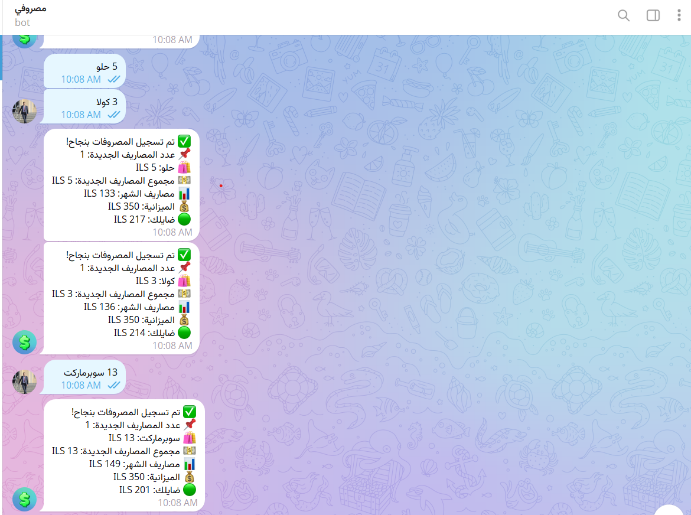
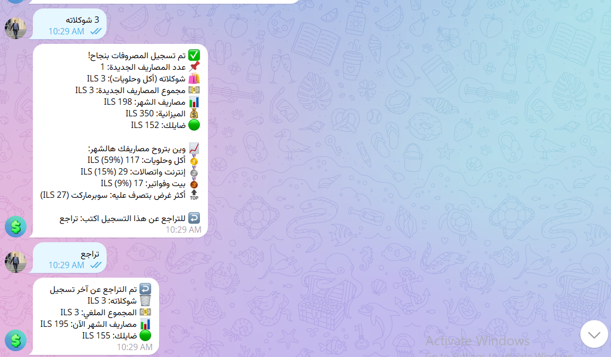
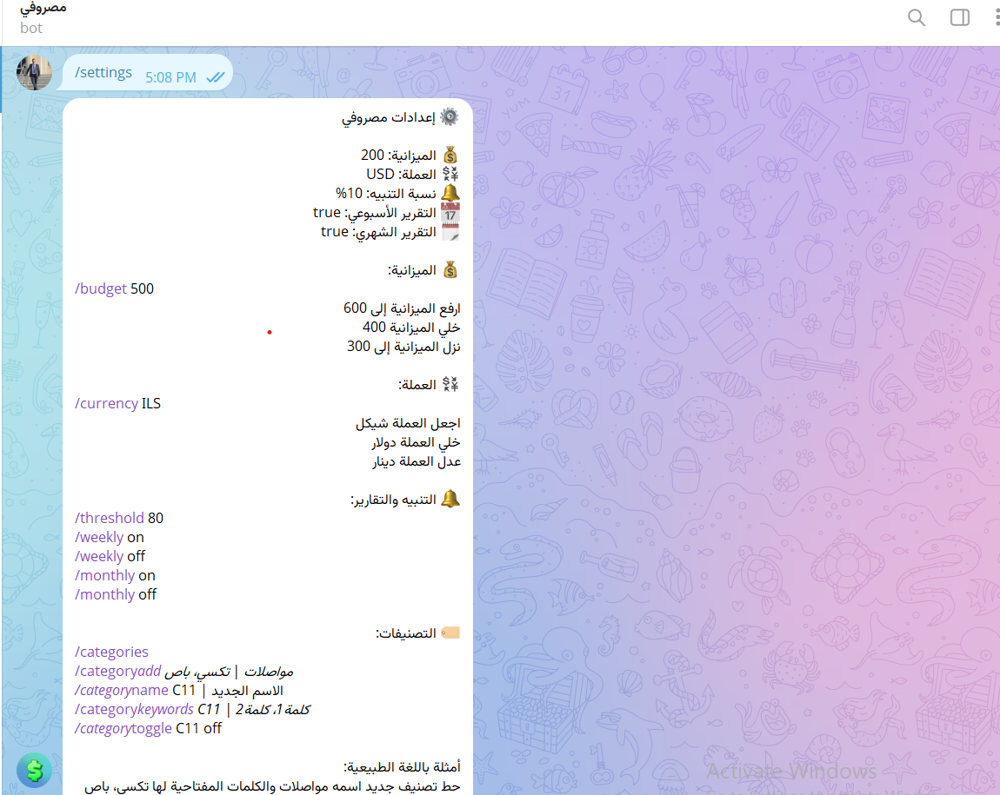
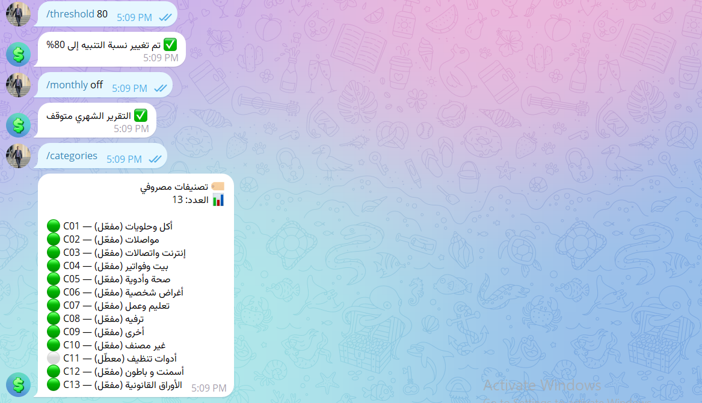

# Masrofi (مصروفي) — Arabic expense tracker bot for n8n

**مصروفي** بوت تيليجرام لتسجيل المصاريف بالعامية الفلسطينية: بتكتب `قهوة ب 5 ومناقيش ب 8` والبوت بيسجّلها بـ Google Sheets، بيصنّفها، وبيحسبلك الميزانية.

A single-user Telegram bot that logs expenses written in Palestinian Arabic, stores them in Google Sheets, categorizes them, tracks a monthly budget and sends reports. Built entirely in **n8n** (one workflow, no custom server), with a **Groq** LLM for understanding free-form messages.

## Screenshots

<p>
  
  
  
</p>
<p>
  
  
</p>

## What it does

| You send | Bot does |
|---|---|
| `قهوة ب 5 ومناقيش ب 8` | Saves two expenses, auto-categorizes, replies with month total, budget left, and your top categories |
| `3 شوكلاته` / `شوكلاته 3` | Both word orders work (a code fallback parser takes over when the AI answer is invalid) |
| `وين بتروح مصاري` | Spending breakdown by category and item, % of budget used, end-of-month projection. Add `اليوم` or `الأسبوع` to change the period |
| `تراجع` (or `/undo`, `الغاء`) | Reverses the last registration (all items from that message). Rows are marked `reversed`, never deleted |
| `تقرير اليوم` / `تقرير أسبوعي` / `تقرير شهري` | On-demand reports |
| `/settings` | Shows current settings and all commands |

**Scheduled:** weekly report every Monday 09:00, monthly report on the 1st at 09:00 (both can be switched off from the bot). A budget alert is sent once per month when spending crosses the threshold.

**Settings from chat** (Arabic natural language or slash commands): `/budget 500`, `ارفع الميزانية إلى 600`, `/currency ILS`, `اجعل العملة دولار`, `/threshold 80`, `/weekly off`, `/monthly on`, `/categories`, `/category_add مواصلات | تكسي، باص`, `ضيف تصنيف جديد اسمه مواصلات والكلمات المفتاحية لها تكسي، باص`, `/category_name C02 | الاسم`, `/category_keywords C02 | كلمة1، كلمة2`, `/category_toggle C02 off`.

**Safety & reliability**
- Only the Telegram user ID in `Settings` can use the bot. Everyone else is rejected **before** any AI or Sheets call, and logged in `AuditLog`.
- Duplicate protection: each expense gets an ID from the Telegram message ID, so a retried update never double-saves.
- The main Google Sheets reads (Settings, Categories, Expenses) retry 3× (the API allows 60 reads/minute/user; every message makes several reads).
- Non-text messages (photos, stickers, voice) get a polite Arabic reply instead of an error.
- An in-workflow **Error Trigger → Notify Error** sends you a Telegram alert when an execution fails.
- All bot replies are Arabic only.

## How it works

```
Telegram Trigger → Control Router ──► settings / category commands ─► Google Sheets ─► reply
                         │
                         └► read Settings → authorized? → has text? → undo? → insights?
                                                                         └► AI Agent (Groq) → Parse Message
                                                                              (+ regex fallback) → Validate/dedupe
                                                                              → append to Expenses → reply + budget alert
Schedule Triggers (weekly, monthly) → read Expenses → build report → Telegram → ReportLog
Error Trigger → Notify Error
```

## Setup

### 1. Create the Google Sheet
Create a spreadsheet with **5 tabs named exactly**: `Expenses`, `Settings`, `Categories`, `AuditLog`, `ReportLog`. Import the matching file from [`sheets/`](sheets/) into each tab (File → Import → *Replace current sheet*). Each file contains the header row; `Settings` and `Categories` also have starter rows.

| Tab | Columns |
|---|---|
| **Expenses** | `expense_id, created_at, expense_date, month_key, user_id, item, amount_ils, category, original_text, telegram_message_id, status, updated_at, reversal_of, notes` |
| **Settings** | `key, value, description, updated_at` — keys: `authorized_telegram_user_id`, `telegram_chat_id`, `monthly_budget_ils`, `currency`, `timezone`, `budget_alert_threshold_percent`, `weekly_report_enabled`, `monthly_report_enabled` |
| **Categories** | `category_id, category_name, keywords, enabled` — keywords are comma-separated (`،` or `,`); the first category whose keyword appears in the item wins |
| **AuditLog** | `event_id, timestamp, user_id, action, expense_id, result, details` |
| **ReportLog** | `report_id, generated_at, report_type, period_start, period_end, total_ils, delivery_status` |

`status` in *Expenses* is `active` or `reversed`. Only `active` rows count in budgets and reports.

### 2. Create the credentials in n8n
- **Telegram API** — create a bot with [@BotFather](https://t.me/BotFather) and paste the token.
- **Google Sheets OAuth2** — standard n8n Google OAuth setup.
- **Groq API** — free key from [console.groq.com](https://console.groq.com). The workflow uses the model `openai/gpt-oss-20b` (temperature 0).

### 3. Import and configure
1. n8n → *Workflows → Import from file* → `masrofi-workflow.json`.
2. In **every Google Sheets node**, set *Document* to your spreadsheet. Fastest way: open the workflow JSON in a text editor and replace `YOUR_GOOGLE_SHEET_ID` with your sheet's ID (the long string in its URL) before importing.
3. Re-select the three credentials on the Telegram, Google Sheets and Groq nodes (they're imported as `REPLACE_ME`).
4. In the **Notify Error** node, replace `YOUR_TELEGRAM_CHAT_ID` with your chat ID.
5. In the `Settings` tab set `authorized_telegram_user_id` to your Telegram user ID (get it from [@userinfobot](https://t.me/userinfobot)). Until you do, the bot rejects everyone.
6. **Publish** the workflow. The Telegram webhook, the schedules and the once-a-month budget alert state only work while it's active.
7. Send your bot `قهوة ب 5`.

## Notes & limitations
- **Single user by design.** Each message does several Sheets reads, so it isn't built for many users or high volume.
- The "budget alert already sent this month" flag lives in n8n workflow static data, which is only saved for production (published) executions.
- The AI only extracts items and amounts; totals, budgets and categories are computed in code, so the numbers never depend on the model.
- Category names in the AI prompt (`أكل وحلويات`, `مواصلات`, …) should match your `Categories` tab, or the keyword matching decides.
- Default timezone is `Asia/Gaza`; change it in `Settings` (and the workflow's timezone setting for the schedules).
